

  

  

  
  
  

  <b>Adunwit Sathapitanon (Bright)</b> · AI Engineer Intern · Thailand 
  Data preparation, recommendation systems, and AI-powered applications.

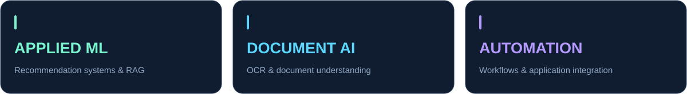

## Selected projects

<a href="https://github.com/blight7z/thaiball-research">
  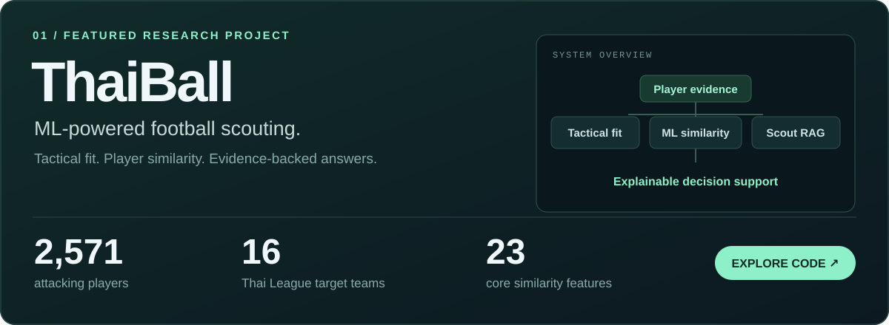
</a>

**What I built**

- **Player matching:** Learned Similarity V3 using Logistic Regression over 23 core feature differences.
- **Evidence-backed answers:** Structured RAG with entity detection, deterministic scoring, citations, Gemini explanations, SSE streaming, and a deterministic fallback.
- **End-to-end delivery:** Next.js + FastAPI through a server-side proxy, with Docker, Render deployment configuration, health/readiness checks, and explicit failure handling.

**[Source code ↗](https://github.com/blight7z/thaiball-research)** &nbsp;·&nbsp; **[Model & validation ↗](https://github.com/blight7z/thaiball-research/blob/main/api/models/model_learned_similarity_v3.json)** &nbsp;·&nbsp; **[RAG evaluation ↗](https://github.com/blight7z/thaiball-research/blob/main/evaluation/results/RAG_EVALUATION_FINAL.md)**

<b>Under the hood: model design & evaluation</b>

Similarity training uses same-player, next-season positive pairs and role-matched proxy negatives. Evaluation includes temporal and unseen-player tests. Scout Chat has a frozen, 30-question benchmark with claim-level evidence auditing.

| Evaluation | Reported result |
| :--- | :--- |
| Similarity: temporal Recall@10 | 51.91% across 836 queries |
| Similarity: strict unseen-player Recall@10 | 54.78% across 115 queries |
| RAG: semantic task completion | 29/30 |
| RAG: strict answer success | 13/30 |

These are offline research results; the model artifact and evaluation report document the criteria and limitations. Similarity scores are not predictions of transfer success.

### More builds

  <a href="https://github.com/blight7z/rov-draft-lab">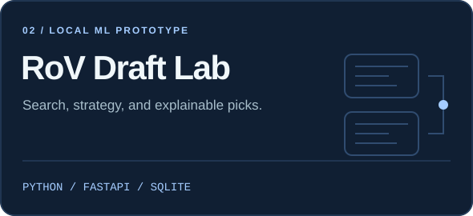</a>
  <a href="https://github.com/blight7z/fa-reuse-flow">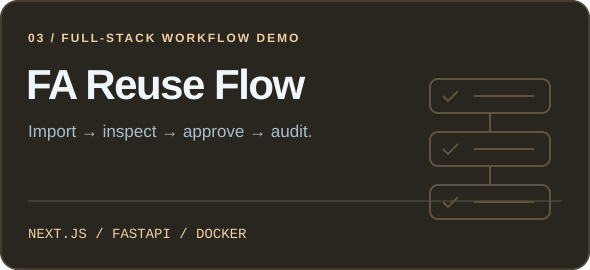</a>

**[RoV Draft Lab ↗](https://github.com/blight7z/rov-draft-lab)** — Local analysis and practice using search, rules, and small-data ML.  
**[FA Reuse Flow ↗](https://github.com/blight7z/fa-reuse-flow)** — Excel import, QC, role-based approvals, and audit trails with synthetic demo data.

## About me

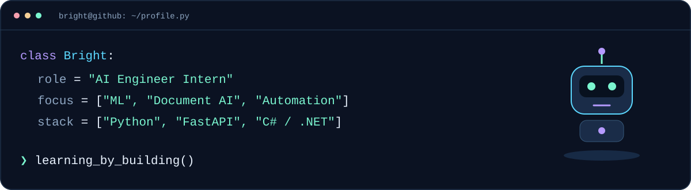

I'm interested in turning data and models into tools people can use, with **clear evaluation**, **traceable outputs**, and **practical application integration**.

## Toolkit

**AI & machine learning**

  
  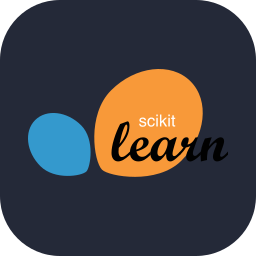
  

`Python` `scikit-learn` `XGBoost` `CatBoost` `LLMs` `RAG` `OCR`

**Applications & interfaces**

  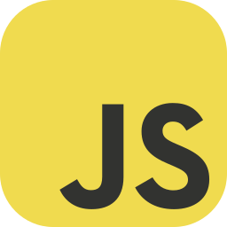
  
  
  
  
  
  

`JavaScript` `TypeScript` `HTML/CSS` `Next.js` `C# / .NET`

**Data, delivery & automation**

  
  
  
  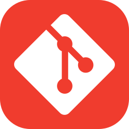

`SQL` `PostgreSQL` `SQLite` `Docker` `Render` `Power Automate` `Windows UI Automation`

Data workflow & engineering practices

Data collection and cleaning · Feature engineering · Model evaluation · Data visualization · Health/readiness checks · Explicit failure handling.

## GitHub activity

<a href="https://github.com/blight7z?tab=overview">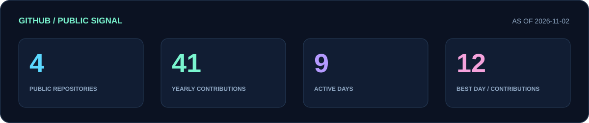</a>

  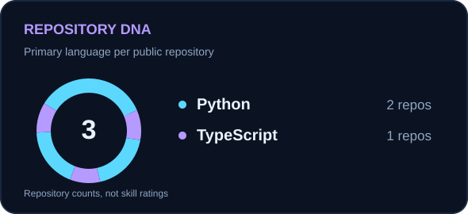
  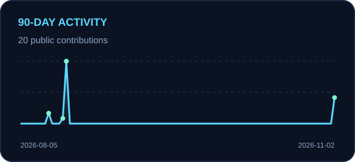

<a href="https://github.com/blight7z?tab=overview">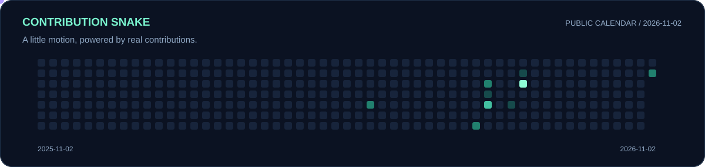</a>

Public activity only. Each card shows its snapshot date. [View the current contribution calendar ↗](https://github.com/blight7z?tab=overview)

## Experience

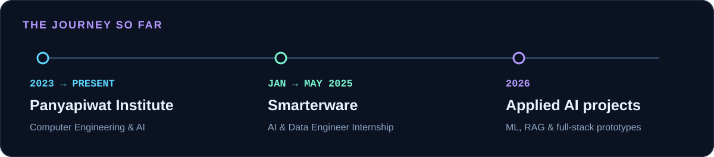

### AI & Data Engineer Intern · Smarterware
**January 2025 – May 2025**

- Collected, retrieved, cleaned, and validated datasets for analytics and machine learning training.
- Contributed to machine learning model development and improvements to training workflows.
- Assisted with LLM experimentation and fine-tuning for chatbot and content summarization prototypes.

Internship completion certificate

**Certificate of Apprenticeship** — Smarterware Co., Ltd.  
Confirmed internship period: **6 January – 30 May 2025**.

## Education

**Panyapiwat Institute of Management**  
Computer Engineering and Artificial Intelligence · **2023 – Present**

## Connect

  
  

  <b>Learning by building. Improving through testing.</b> 
  <a href="https://github.com/blight7z?tab=repositories">Explore all repositories ↗</a>

Credits & profile details

Technology icons: [Skill Icons](https://github.com/tandpfun/skill-icons), MIT licence retained in this repository.  
Design inspiration: [DenverCoder1](https://github.com/DenverCoder1), [Platane](https://github.com/Platane), and [lowlighter](https://github.com/lowlighter).  
The contribution animation and statistics cards are generated from public GitHub data by the script in this repository.

