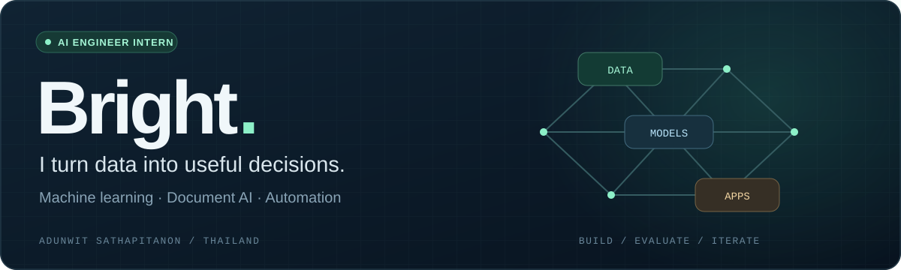

  

  <a href="#selected-projects">Explore projects</a> &nbsp;·&nbsp;
  <a href="#experience">Experience</a> &nbsp;·&nbsp;
  <a href="#toolkit">Toolkit</a> &nbsp;·&nbsp;
  <a href="https://github.com/blight7z?tab=repositories">All repositories ↗</a>

I'm **Adunwit Sathapitanon (Bright)**, an **AI Engineer Intern based in Thailand**. I work across data preparation, machine learning, recommendation systems, and AI-powered applications.

My current interests: **document AI & OCR**, **workflow automation**, and **integrating AI with existing applications**.

## Selected projects

**What I built**

- **Player matching:** Learned Similarity V3 using Logistic Regression over 23 core feature differences.
- **Evidence-backed answers:** Structured RAG with entity detection, deterministic scoring, citations, Gemini explanations, SSE streaming, and a deterministic fallback.
- **End-to-end delivery:** Next.js + FastAPI through a server-side proxy, with Docker, Render deployment configuration, health/readiness checks, and explicit failure handling.

**[Source code ↗](https://github.com/blight7z/thaiball-research)** &nbsp;·&nbsp; **[Model & validation ↗](https://github.com/blight7z/thaiball-research/blob/main/api/models/model_learned_similarity_v3.json)** &nbsp;·&nbsp; **[RAG evaluation ↗](https://github.com/blight7z/thaiball-research/blob/main/evaluation/results/RAG_EVALUATION_FINAL.md)**

<b>Under the hood: model design & evaluation</b>

Similarity training uses same-player, next-season positive pairs and role-matched proxy negatives. Evaluation includes temporal and unseen-player tests. Scout Chat has a frozen, 30-question benchmark with claim-level evidence auditing.

| Evaluation | Reported result |
| :--- | :--- |
| Similarity: temporal Recall@10 | 51.91% across 836 queries |
| Similarity: strict unseen-player Recall@10 | 54.78% across 115 queries |
| RAG: semantic task completion | 29/30 |
| RAG: strict answer success | 13/30 |

These are offline research results; the model artifact and evaluation report document the criteria and limitations. Similarity scores are not predictions of transfer success.

### More builds

  
  

**[RoV Draft Lab ↗](https://github.com/blight7z/rov-draft-lab)** — Local analysis and practice using search, rules, and small-data ML.  
**[FA Reuse Flow ↗](https://github.com/blight7z/fa-reuse-flow)** — Excel import, QC, role-based approvals, and audit trails with synthetic demo data.

## Experience

### AI & Data Engineer Intern · Smarterware
**January 2025 – May 2025**

- Collected, retrieved, cleaned, and validated datasets for analytics and machine learning training.
- Contributed to machine learning model development and improvements to training workflows.
- Assisted with LLM experimentation and fine-tuning for chatbot and content summarization prototypes.

Internship completion certificate

**Certificate of Apprenticeship** — Smarterware Co., Ltd.  
Confirmed internship period: **6 January – 30 May 2025**.

## Toolkit

`Python` `SQL` `scikit-learn` `FastAPI` `Next.js` `C# / .NET` `Power Automate`

Full toolkit & data workflow

**AI & data**  
`XGBoost` `CatBoost` `LLMs` `OCR` `RAG`

**Data workflow**  
`Data Collection` `Data Cleaning` `Feature Engineering` `Model Evaluation` `Data Visualization`

**Applications & integration**  
`JavaScript` `TypeScript` `HTML/CSS` `Windows UI Automation`

**Storage & deployment**  
`SQLite` `PostgreSQL` `Docker` `Render`

## Education

**Panyapiwat Institute of Management**  
Computer Engineering and Artificial Intelligence · **2023 – Present**

---

  Learning by building. Improving through testing. 
  <a href="https://github.com/blight7z?tab=repositories">Explore the code ↗</a>

