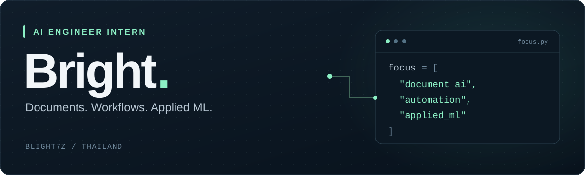

  

  <a href="#about">About</a> &nbsp;·&nbsp;
  <a href="#experience">Experience</a> &nbsp;·&nbsp;
  <a href="#selected-projects">Projects</a> &nbsp;·&nbsp;
  <a href="#education">Education</a> &nbsp;·&nbsp;
  <a href="#toolkit">Toolkit</a>

## About

I'm **Adunwit Sathapitanon (Bright)**, an **AI Engineer Intern based in Thailand**.

I work on **data preparation, machine learning, recommendation systems, and AI-powered applications**. My current interests include **OCR and document understanding**, **workflow automation**, and **integrating AI with existing applications**.

## Experience

### AI & Data Engineer Intern · Smarterware
**January 2025 – May 2025**

- Collected, retrieved, cleaned, and validated datasets for analytics and machine learning training.
- Contributed to machine learning model development and improvements to training workflows.
- Assisted with LLM experimentation and fine-tuning for chatbot and content summarization prototypes.

**Internship completion certificate:** Certificate of Apprenticeship, Smarterware Co., Ltd. · 6 January – 30 May 2025.

## Selected projects

### [ThaiBall / AI Scout Assistant ↗](https://github.com/blight7z/thaiball-research)
**Football recruitment decision support · Research project**

Built an end-to-end scouting application covering **2,571 attacking players** and **16 Thai League target teams**.

- **Learned Similarity V3:** Developed a Logistic Regression model using absolute differences across 23 core features, with same-player, next-season positive pairs and role-matched negative pairs.
- **Structured RAG:** Implemented entity detection, deterministic retrieval and scoring, cited evidence, Gemini explanations, SSE streaming, and a deterministic fallback.
- **Application integration:** Connected a Next.js frontend and FastAPI backend through a server-side proxy, with Docker and Render deployment configuration, health/readiness checks, and explicit error handling.

`Python` `scikit-learn` `FastAPI` `Next.js` `RAG` `Docker`

### More projects

| Project | What it explores | Built with |
| :--- | :--- | :--- |
| **[RoV Draft Lab ↗](https://github.com/blight7z/rov-draft-lab)** Explainable recommendations | A local draft analysis and practice prototype using search, rules, and small-data ML. | Python · FastAPI · TypeScript · SQLite |
| **[FA Reuse Flow ↗](https://github.com/blight7z/fa-reuse-flow)** Workflow automation | An equipment buyback demo covering Excel import, QC, role-based approvals, and audit trails with synthetic data. | Next.js · FastAPI · PostgreSQL · Docker |

## Education

**Panyapiwat Institute of Management**  
Computer Engineering and Artificial Intelligence · **2023 – Present**

## Toolkit

**AI & data**  
`Python` `SQL` `scikit-learn` `XGBoost` `CatBoost` `LLMs` `OCR` `RAG`

**Data workflow**  
`Data Collection` `Data Cleaning` `Feature Engineering` `Model Evaluation` `Data Visualization`

**Applications & integration**  
`C#` `.NET` `JavaScript` `TypeScript` `HTML/CSS` `FastAPI` `Next.js`

**Automation, storage & deployment**  
`Power Automate` `Windows UI Automation` `SQLite` `PostgreSQL` `Docker` `Render`

---

  Learning by building. Improving through testing. 
  <a href="https://github.com/blight7z?tab=repositories">Explore the code ↗</a>

